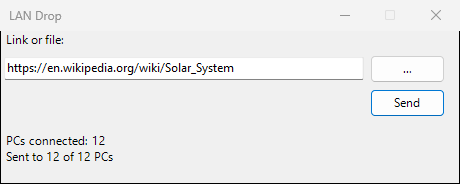
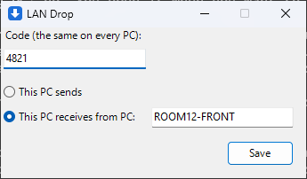

# LAN Drop

Sends a web link or a file from one PC to every other PC on the local network, where it opens
by itself. Runs on Windows 7 and later with nothing to install: it uses .NET Framework 3.5,
which is part of Windows 7, or 4.x on newer Windows. Its text is in Ukrainian when Windows is
set to Ukrainian, and in English otherwise.

| The PC that sends | A receiving PC, first run only |
|---|---|
|  |  |

## Build

```
dotnet build -c Release
dotnet test -c Release
```

The app is `LanDrop.exe` and `LanDrop.exe.config` in `src/LanDrop/bin/Release/net35/`.

## Setting up

1. Copy `LanDrop.exe` and `LanDrop.exe.config` into a folder on each PC. Not a USB stick: the
   PC starts the app from that folder at every sign-in, and saves its settings beside it.
2. On the PC that sends: run it, type a code, choose "This PC sends" ("Цей ПК надсилає"). When
   Windows asks about the firewall, allow it (this needs an administrator), or the other PCs
   cannot connect.
3. On every other PC: run it, type the same code, choose "This PC receives from PC:" ("Цей ПК
   отримує від ПК:") and type the sending PC's name (Control Panel, System, Computer name). From then on it runs in the
   background and starts with Windows for that user.

Links open in the default browser. Files are saved to a `LAN Drop` folder on the desktop and
opened with the program Windows uses for them.

"Sync time" ("Синхронізувати час") sets the date and time on every connected PC to the sending
PC's; time zones are left alone. A PC changes its clock only if the account signed in on it can
do that without a prompt (an administrator with UAC off, for example); otherwise its clock
stays as it was.

The sending window lists the connected PCs by name, or by IP address when Windows cannot find a
PC's name. On the other PCs, the LAN Drop icon by the clock (a blue square with a white arrow) shows
while the PC is connected to the sending PC, and a warning sign while it is not; point at it to
read which.
Windows may hide the icon behind the arrow next to the clock.

To change the settings on a receiving PC, right-click its icon by the clock and choose "Open
settings" ("Відкрити налаштування"); "Close" ("Закрити") stops LAN Drop on that PC until the next
sign-in. On the sending PC, delete `lan-drop.ini` beside the exe and run it again. To stop it
starting with Windows, remove "LAN Drop" from startup: msconfig, Startup on Windows 7; Task
Manager, Startup on Windows 8 and later.

## Limits

- The code stops casual misuse only. Anyone who can read `lan-drop.ini` on a receiving PC can
  send to every PC.
- Anyone at a receiving PC can close LAN Drop there, or see and change its settings, from the
  icon by the clock.
- Nothing is encrypted on the network.
- Starting with Windows is per Windows user: on a PC with several accounts, run it once under
  each.
- It uses TCP port 17850.
